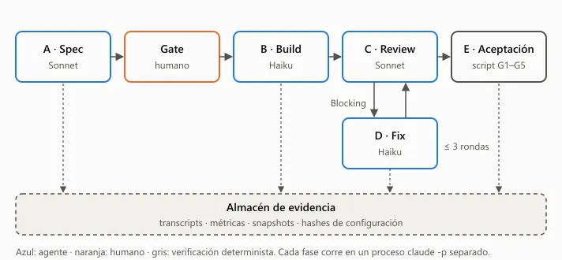
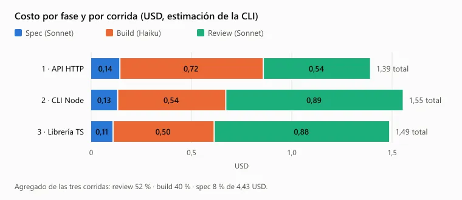

### Un agente sin contexto es un usuario final barato, repetible y medible. Cómo lo aislé, qué medí y qué falló en mi propio arnés al probar un CLI.

*por Camilo — 14 de noviembre de 2026 · [LinkedIn](https://www.linkedin.com/in/ernestocamilovera/)*

---

Cuatro agentes recibieron la misma regla de juego: construir algo con una herramienta que no conocían, usando únicamente lo que está publicado, el paquete en el registro y su README. Los cuatro terminaron. Los cuatro pasaron las verificaciones. Y ninguno llegó ahí por el camino que la documentación recomendaba.

La herramienta bajo prueba es stackfold, un CLI de scaffolding con plugins que mantengo yo. Que funcione para quien la escribió dice poco; quería saber si funciona para alguien que solo tiene el paquete y su README. Para eso necesitaba un usuario externo, repetible y barato, y un agente de IA sin contexto previo cumple las tres condiciones, siempre que se lo aísle con cuidado.

Lo que se les pidió construir es un plugin de stackfold, es decir, un generador que, a partir de unas preguntas, crea un proyecto nuevo en disco. Cada agente recibió una especificación distinta:

- **Piloto, "hello-world":** un plugin mínimo para depurar el arnés, sin peso en los resultados.
- **Corrida 1, `node-http-api-stackfold`:** un microservicio HTTP en Node.js y TypeScript sin dependencias de ejecución (solo `node:http`), con router, parseo de JSON, logs estructurados, endpoints de salud y cierre ordenado; CORS, Dockerfile y un recurso de ejemplo son opcionales.
- **Corrida 2, `node-cli-stackfold`:** una herramienta de línea de comandos con `commander`, binario instalable, subcomando de ejemplo, tests y, de forma opcional, carga de configuración desde archivo.
- **Corrida 3, `ts-library-stackfold`:** una librería TypeScript lista para publicar en npm, con mapa `exports` correcto, tipos incluidos, build reproducible, tests y CI opcional en GitHub Actions.

Son tres tipos de proyecto bastante distintos, y eso importa más adelante: lo que se repite entre ellos no puede atribuirse a que se parecen.

El resultado más incómodo: los cuatro builders abrieron el código compilado del paquete (`dist/`) entre 6 y 9 veces por construcción, y los archivos de tipos (`.d.ts`) entre 2 y 7 veces según cómo se cuente. Lo hicieron temprano: la primera lectura de `dist/` cae entre los mensajes 2 y 6 de construcciones de 32 a 56 mensajes. No fue un último recurso tras agotar el README sino parte del método desde el arranque, para averiguar contratos que el README no daba.

Más precisamente: para un plugin con validación de entradas, el README describe un flujo (escribir `scaffold.ts`, sintetizarlo a `scaffold.json`, registrarlo) que descarta la validación sin avisar. Ninguno de los cuatro entregó por ahí. "El agente terminó" y "la ruta publicada alcanza" son afirmaciones distintas, y solo la segunda dice algo sobre la usabilidad. Este artículo es sobre cómo medir esa diferencia sin engañarse.

Los datos salen de tres corridas completas y un piloto, ejecutados el 9 de noviembre de 2026 en un solo equipo (Windows 11, Node 24, Claude Code CLI 2.1.319). Es n=3, así que todo es descriptivo. Y como casi todos los errores serios fueron de mi arnés y no del producto, hay una sección dedicada a ellos.

## Un agente sin contexto como instrumento de medición

La tesis: si se lo aísla, se le fija el contexto y se separan los roles, la fricción de un agente es una medición de usabilidad, no una anécdota. Tres afirmaciones, y un contraargumento al final.

La primera: el dogfooding con agentes mide la ruta documentada, no la intención del autor. Un humano que conoce su herramienta rellena los huecos del README sin notarlo; un agente sin memoria los encuentra todos, porque cada hueco se convierte en una lectura de código fuente.

La segunda: la recurrencia entre sesiones independientes es la señal. Una queja de un agente es ruido; la misma queja en cuatro de cuatro sesiones es un defecto.

La tercera: el arnés es la mitad del resultado. Un experimento así falla más por cómo se mide que por lo que se mide.

El contraargumento hay que reconocerlo de entrada: un agente no es una persona. Mide fricción de lectura y de contrato (¿qué dice la documentación? ¿qué hace el código?), no percepción, ni estética, ni la intuición con la que un humano desconfía de ciertas cosas.

## Tres roles, sesiones separadas, contexto congelado

Cada agente es un proceso `claude -p` independiente, no una conversación larga. Es reproducible, admite límites duros y deja el transcript completo en disco. Es la misma lógica de aislamiento que [desarmé al hablar del harness de Claude](/my-articles/un-agente-no-es-un-chat-con-mas-paciencia/): una sesión separada es la forma de que un rol no contamine a otro.

| Fase | Rol | Modelo | Qué hace | Salida |
| --- | --- | --- | --- | --- |
| A | Spec-writer | Sonnet 5.5 | Escribe la especificación del entregable a partir de un brief corto | `spec.md` |
| Gate | Humano | — | Aprueba o edita el spec antes de construir | `gate.json` |
| B | Builder | Haiku 5.5 | Construye usando solo el producto publicado y su README; anota fricciones | código + `FRICTION.md` |
| C | Reviewer | Sonnet 5.5 | Sesión nueva; revisa con una rúbrica fija y emite `VERDICT` | `review-N.md` |
| D | Fix | Haiku 5.5 | Corrige hallazgos Blocking (máximo 3 rondas) | código |
| E | Aceptación | Script determinista | Gates objetivos G1–G5 (G6 sale del review) | `acceptance.json` |



Cuatro decisiones de diseño detrás de esa tabla. El builder es de piso a propósito: si un modelo de nivel medio-bajo llega a un entregable funcional, uno más fuerte también, y la fricción que paga el modelo chico es la que más información da. El spec lo escribe otro agente, porque quien construye no debería calificar su propio plan. Lo que puede verificarse con un script se verifica así, y el reviewer cubre lo que el script no ve. Y el orden de las corridas se sorteó con semilla fija (2023803734) y se registró antes de empezar, salvo una restricción declarada: una corrida tenía base previa y fue primera.

Para que el agente se comporte como usuario externo, el aislamiento tiene reglas concretas: solo el paquete publicado y su README, sin repositorio fuente ni ADRs internos; plugins y skills de fábrica solamente, sin servidores MCP; memoria automática desactivada; y respaldo y restauración de la configuración global del usuario alrededor de cada agente, porque la herramienta bajo prueba podría escribirla. La web quedó permitida, porque un usuario real puede buscar; ningún agente la usó, y no sé si un repositorio público habría ayudado.

La invocación usa flags documentados de la CLI de Claude Code[^1]:

```bash
claude -p \
  --output-format stream-json --verbose \
  --model <rol> --effort <rol> \
  --allowedTools "<lista explícita>" --permission-mode acceptEdits \
  --strict-mcp-config --setting-sources project --settings <archivo> \
  --no-session-persistence \
  --max-budget-usd 10 \
  < prompt.md
```

`--allowedTools` explícito y `--permission-mode acceptEdits` dejan al agente editar sin ampliar sus propios permisos, el mismo principio de [permisos como código y no como etiqueta](/my-articles/la-autonomia-cambia-la-pregunta-de-seguridad/) de la serie anterior. El tope de gasto nunca se activó.

Los topes de ejecución se fijaron antes de correr: 75 turnos para builder y review, 30 para el spec, 70 minutos por fase y tres rondas de fix. Configuración, settings y plantillas de prompt se hashearon, y los hashes resultaron idénticos en las tres corridas y el piloto; eso es lo que permite decir que las corridas son comparables.

La aceptación final la decide un script, no una opinión:

| Gate | Qué verifica |
| --- | --- |
| G1 | El entregable se registra y lista correctamente en la herramienta |
| G2 | La herramienta lo ejecuta de punta a punta con respuestas por defecto y completas |
| G3 | El proyecto generado instala, compila y pasa sus tests |
| G4 | Un paso de generación es determinista (misma entrada, misma salida) |
| G5 | Convenciones estáticas verificables (parcial) |
| G6 | El reviewer no reporta hallazgos Blocking tras ≤ 3 rondas |

Antes de las corridas válidas ejecuté un piloto desechable ("hello-world": 295 s, 32 turnos, aprobado). No cuenta para costo y tiempo; sirvió para depurar el arnés. Sí lo uso como una cuarta sesión de builder en el análisis de recurrencia, y lo digo explícitamente porque cambia el denominador.

## Qué medir para no engañarse

Tres preguntas guían la medición. ¿Alcanza la ruta publicada? ¿Cuánto cuesta y cuánto varía? ¿Qué se repite entre entregables?

| Métrica | Fuente | Nota de rigor |
| --- | --- | --- |
| Turnos | Mensajes de asistente con `id` distinto en el stream-json | El `num_turns` de la CLI es mayor (68/58/56 contra 51/42/56 en build; en la corrida 3 coinciden). Hay que declarar la unidad |
| Tokens | Campo `usage` del resultado | El volumen real es lectura de caché (5,4–7,5 M por build); sumar "tokens totales" entre fases mezcla magnitudes |
| Costo USD | `total_cost_usd` del resultado | Estimación del lado del cliente que reporta la CLI, no la factura[^1] |
| Tiempo de reloj | Por fase | Dominan los ciclos de verificación (instalar, compilar, probar), no la salida |
| Lecturas de `dist/`, README y `.d.ts` | Recuento sobre el transcript | La expresión regular inicial sub-contaba; el resultado depende de la definición (10 / 8 / 9 llamadas que mencionan el README contra 11 / 9 / 11 referencias) |
| Fricciones | `FRICTION.md` del builder y hallazgos del reviewer | Autoinformadas: se priorizan las corroboradas |
| Hallazgos del review | Severidad y origen (entregable / docs / producto) | El origen separa "el agente lo hizo mal" de "la herramienta lo hizo difícil" |

La última fila es la parte más valiosa del diseño. Una misma queja puede ser un defecto del producto, un hueco de documentación o un defecto del entregable que el agente produjo, y sin esa clasificación un reporte de fricción no tiene destinatario. De los 34 hallazgos de los reviewers, 23 eran defectos de lo que construyó el agente, 6 huecos de documentación, 4 del producto y 1 informativo. Un reporte sin origen habría atribuido casi todo a stackfold.

Una celda de esa tabla merece cuenta aparte, porque la cifra de mi informe inicial era incorrecta. Una sesión vacía pesa unos 20–21 mil tokens. Contada una sola vez es el 0,2–0,3 % de la lectura de caché de una corrida, aparentemente despreciable. Pero ese prefijo fijo se relee en cada turno, y multiplicado por los mensajes de cada fase equivale, por estimación, a entre el 10 y el 12 % de la lectura de caché de un build y entre el 20 y el 30 % de la de un review (en tokens, no en dólares, suponiendo que cada mensaje de asistente es una llamada a la API). La suma por mensaje coincide al token con la que reporta la CLI, y ahí se valida el método; lo que cambia la conclusión es la unidad con que se divide.

Para separar señal de ruido usé un umbral: una fricción se promueve a "defecto a atender" cuando aparece en al menos tres sesiones independientes de builder. Es una analogía deliberada con el modelo de Nielsen y Landauer, según el cual cinco usuarios descubren la mayor parte de los problemas de una interfaz[^3]. Mi umbral es una heurística, no una derivación de ese modelo, que además vale para usuarios comparables. Hay una consecuencia incómoda: cuatro sesiones del mismo modelo con el mismo prompt son independientes en contexto, pero probablemente más correlacionadas en comportamiento que cuatro personas. La recurrencia es evidencia, no prueba.

## El review pesó más que el build

Las tres corridas pasaron todos los gates aplicables y el review, sin rondas de fix. Cada entregable costó en promedio unos 1,48 USD y ~23 minutos; el total fue de 4,43 USD y 69 minutos de agente. El piloto (0,37 USD) va aparte. Los totales se calculan antes de redondear, por eso una fila puede diferir en un centavo de la suma de sus partes.

| Corrida | Spec | Build (Haiku) | Review (Sonnet) | Total | Hallazgos (Should-fix / Nit / info) |
| --- | --- | --- | --- | --- | --- |
| 1: API HTTP | 0,14 USD · 58 s | 0,72 USD · 1.117 s · 51 turnos | 0,54 USD · 315 s · 26 turnos | 1,39 USD · 1.490 s | 3 / 5 / 0 |
| 2: CLI Node | 0,13 USD · 53 s | 0,54 USD · 683 s · 42 turnos | 0,89 USD · 437 s · 35 turnos | 1,55 USD · 1.173 s | 8 / 3 / 1 |
| 3: Librería TS | 0,11 USD · 42 s | 0,50 USD · 873 s · 56 turnos | 0,88 USD · 554 s · 31 turnos | 1,49 USD · 1.469 s | 6 / 8 / 0 |



Tres lecturas. La primera: el review costó más que el build en 2 de 3 corridas (57 % y 59 % del gasto), aunque el builder es quien más tokens emite. En el agregado, el review se llevó el 52 %, el build el 40 % y el spec el 8 %. Si el costo importa, la palanca es el reviewer: diseñar su rúbrica y su tope de turnos es diseñar el presupuesto. Y el costo es una estimación del cliente: sirve para comparar fases, no para conciliar una factura.

La segunda: el gate humano no cambió nada. Los tres specs se aprobaron sin edición, y sus defectos (un check imposible de cumplir, un comando POSIX en un host Windows, defaults contradictorios) llegaron intactos al builder y al reviewer. Un humano al que solo se le pide "aprobar" aprueba; si se quiere que el gate atrape algo, necesita una lista de verificación concreta.

La tercera es una cautela: los rangos (19,6 a 24,8 minutos y 1,39 a 1,55 USD) son modestos, pero con n=3 no se atribuyen a ninguna causa. En conducta, los builders hicieron entre 55 y 67 llamadas a herramientas, cero usos de la web y dos llamadas denegadas por permisos (en una sola corrida).

## Lo que encontraron los agentes

**El peor defecto para un agente es el fallo silencioso.** El caso más grave fue `scaffold synth`, que descartaba las funciones de validación del plugin con código de salida 0 y sin aviso, mientras el README describe esos plugins como autorados en TypeScript con sus `validate` incluidos. Fragmento de la corrida 2, recortado:

```text
$ stackfold scaffold synth ./plugin
stackfold scaffold synth: wrote …\plugin\scaffold.json
EXIT=0

$ grep -o '"validate[^"]*"' plugin/scaffold.json | head -3
(sin coincidencias)
```

Tres de los cuatro builders ejecutaron el comando y vieron lo mismo. El cuarto, el de la librería, llegó a la misma conclusión sin ejecutarlo: leyó el código de `synth` y vio que serializa la definición como JSON, y las funciones no sobreviven a eso. Los cuatro encontraron el mismo desvío: un módulo `.js` con export por defecto conserva las funciones. Dos lo escribieron a mano, uno compiló el TypeScript con el esbuild que ya estaba en las dependencias y el piloto lo compiló con `tsc`. Ese contrato, qué exporta el módulo y cómo se produce, no está en el README, y de ahí sale buena parte de las lecturas de `dist/`.

Hay que ser preciso con lo que se demostró, porque mi informe inicial decía más de lo que los datos permiten. El fallo silencioso está confirmado por ejecución en tres sesiones y, de forma independiente, el reviewer de la corrida 2 lo reprodujo desde cero. Lo que no está demostrado es el daño: ningún plugin entregado aceptó una entrada inválida, porque los cuatro encontraron el desvío antes de entregar, y el reviewer verificó que el plugin final rechaza nombres como `My_CLI`. Que un autor que siguiera el README al pie de la letra enviaría un plugin sin validación es una deducción a partir del código del orquestador, que solo valida si la función existe. Sólida, pero deducción.

Hay una segunda corrección, de signo contrario a lo que esperaba. Había planteado que un agente sin intuición confía en el código de salida y un humano a veces desconfía. Los transcripts dicen otra cosa: el builder de la corrida 2 corrió `synth` para ver si las funciones de validación sobrevivían, y verificó el contenido del archivo en vez de creerle al exit 0. Lo que disparó la verificación no fue la desconfianza sino el spec, que exigía rechazar nombres inválidos. Un plugin sin ese requisito habría pasado todos los gates con el fallo intacto. Un criterio de aceptación explícito es lo que convierte un fallo silencioso en uno visible, para un agente y probablemente también para una persona.

Que tres de cuatro sesiones toparan con el fallo, el cuarto lo anticipara y el reviewer lo señalara por su cuenta es la evidencia para tratarlo como defecto y no como rareza. Es la idea de [verificar en vez de repetir](/my-articles/post-1-md-view-the-story/) de la serie de md-view.

**La recurrencia separó lo firme de lo anecdótico.** De 12 fricciones registradas, 4 aparecieron en 3 o 4 de las 4 sesiones de builder; las otras 8, con una o dos, quedan como observaciones.

| # | Fricción | Apariciones (de 4 sesiones) | Origen |
| --- | --- | --- | --- |
| 1 | `scaffold synth` descarta `validate` sin aviso; el README dice lo contrario | **4** | producto + docs |
| 2 | Contrato de `scaffold.js` (export por defecto) y paso TS→JS sin documentar | **4** | docs |
| 3 | `plugin register` sin `--project` escribe en la configuración global del usuario | **4** | docs |
| 4 | `init plugin-scaffold <dir>` exige que el directorio coincida con el id del plugin; el README muestra otro uso | **3** | docs |
| — | *Umbral de recurrencia: 3 sesiones* | | |
| 5 | `file()` descarta tres opciones de escape que no figuran en su tipo | 2 | producto |
| 6 | La configuración de proyecto no se busca "hacia arriba", como afirma el README | 2 | producto + docs |
| 9 | El directorio destino es independiente de `name`; el spec esperaba derivarlo | 2 | producto |
| 10 | Opciones de Handlebars y operadores de `when` solo documentados en el código | 2 | docs |
| 7 | `init` sin `--config`/`--answer` en shell no interactiva sale con 130 | 1 | producto |
| 8 | `init` con un stack inexistente imprime todo el catálogo antes del error | 1 | producto |
| 11 | `--answer` con salto de línea guarda solo la primera línea (sin verificar) | 1 | producto, sin confirmar |
| 12 | `deriveAnswer` no ofrece la fecha actual, solo el año | 1 | producto |

Las cuatro firmes son sobre todo documentación, y por eso la corrección es barata. Sin repetición, el reporte autoinformado de un agente no justifica una decisión.

**Comparar entregables independientes revela primitivas que faltan.** Al comparar los cuatro entregables con similitud de Jaccard sobre líneas no vacías aparecieron patrones repetidos: la misma base TypeScript con vitest (`tsconfig.json` y `vitest.config.ts`, 4 de 4), el mismo `.gitignore`, helpers de gating propios (3 de 3) y un validador de nombre de paquete en cada uno. Aquí también me corregí: mi informe inicial decía que cuatro agentes escribieron el mismo validador con cuatro expresiones regulares distintas, y no fue así. Cada spec, escrito por una sesión distinta del spec-writer, pedía una regla algo diferente, y los builders implementaron lo pedido. La divergencia nació río arriba. Lo que sí sostiene la señal es que un spec-writer que no encuentra un validador compartido inventa una regla distinta cada vez, y que la de la librería, la más cercana a las reglas de npm, acepta nombres que npm rechaza.

El dato más fuerte es una ausencia: ninguno usó `mountFragment` ni `composeFragments`, las primitivas de composición de la herramienta. Existen, pero no hay un catálogo de fragmentos publicados para montar ni un ejemplo en el camino de autoría externa. Cuando agentes independientes reconstruyen la misma base y la primitiva para reutilizarla no tiene nada que ofrecer, es un problema de producto.

**"Cero Blocking" es un criterio de aprobación demasiado permisivo.** Las tres corridas pasaron sin rondas de fix mientras 17 hallazgos Should-fix quedaron sin atender por protocolo. La métrica "rondas de review" no discriminó nada; la severidad por hallazgo y su origen sí. Es el patrón de [el bug que sobrevivió nueve revisiones](/my-articles/post-4-md-view-the-story/): un chequeo puede pasar en verde por lo que no se le pidió mirar.

## Lo que falló en mi propio arnés

Esta sección es la que más diferencia un experimento de una demo. Casi todos los problemas serios fueron del instrumento, y la mayoría se detectó antes de las corridas válidas gracias al piloto y a un preflight automatizado.

| # | Qué falló | Efecto | Corrección |
| --- | --- | --- | --- |
| 1 | La CLI no estaba en el `PATH`, y un bug del preflight marcó `--effort` como no soportado para todos los roles | Configuración envenenada | Aborto temprano si la CLI no corre; "no soportado" solo si el error menciona el flag; config reseteada |
| 2 | El chequeo de aislamiento contaba plugins y skills de fábrica como fuga | Falso fallo | Redefinido como "solo de fábrica, sin MCP, sin memoria automática" |
| 3 | **La memoria automática por directorio estaba activa** | Habría roto la independencia entre roles | Desactivada por settings y por variable de entorno; verificado `autoMemory=off` |
| 4 | Un parche del runner no se guardó | El cambio parecía aplicado y no lo estaba | Rehecho en un solo script con verificación |
| 5 | Conteos manuales o por script erróneos (informé "6 Should-fix + 6 Nits" cuando eran 8 / 3 / 1) y un contador de lecturas del README que sub-contaba | Cifras del informe incorrectas | Recuento con script sobre los archivos crudos; corrección anotada en el log |
| 6 | El spec exigía `kill -TERM` (POSIX) en un host Windows | Check no verificable | Registrado como defecto de spec, no del producto |
| 7 | El gate G4 ejecutaba `synth` dentro de la carpeta del plugin | El snapshot incluía un `scaffold.json` que el builder nunca entregó | Detectado en el piloto; hay que leer los snapshots sabiendo que el gate los contamina |

El caso estrella es el 3. Builder, reviewer y fix comparten directorio de trabajo, y la memoria automática persiste entre sesiones por directorio. Sin desactivarla, lo que un agente aprendía del producto en una fase habría viajado a la siguiente, y la "sesión fresca" del reviewer no lo habría sido. Era una fuga silenciosa de contexto, y la única razón por la que la encontré es que verifiqué el aislamiento en lugar de suponerlo.

De ahí salen cuatro lecciones. Un piloto desechable y un preflight antes de gastar presupuesto: que el piloto no cuente permite arreglar el arnés sin sesgo. Verificar el aislamiento, no suponerlo. Corregir en público: cada cifra mal informada se corrigió en el log con su causa. Y medir una vez, con una fuente: todo recuento manual se contrasta con un script sobre los archivos crudos.

## Límites, y qué haría distinto

Declaro los límites de frente porque sostienen la credibilidad del resto.

- **n=3 sin repeticiones.** No hay inferencia entre entregables ni entre modelos, y la variación de costo y tiempo no es atribuible a una causa.
- **Builder de piso.** Que terminaran indica que el piso de usabilidad es alcanzable, no que sea cómodo: pagaron la fricción con lecturas de código y workarounds. Los números no se extrapolan a modelos más fuertes.
- **Familia de modelos compartida.** Spec-writer, builder y reviewer son de la misma familia, con posible sesgo de preferencia: la literatura documenta que un LLM evaluador tiende a puntuar mejor sus propias generaciones[^2]. Ese estudio no probó modelos Claude, así que no sé cuánto se traslada, y tampoco probé un reviewer de otra familia.
- **Gates parciales.** Un gate fue "n/a" en 2 de 3 corridas y otro solo cubre convenciones estáticas; el resto depende del reviewer.
- **Aislamiento de contexto, no de efectos.** Los agentes ejecutan Bash sin sandbox bajo mi usuario y trabajan en una carpeta fuera del repo, pero nada los confina allí. Los permisos funcionaron donde se probaron (la CLI denegó un PowerShell para detener procesos por puerto), pero hubo un tropiezo real: en la corrida 3, un `rm` falló con `Device or resource busy` dentro de una línea encadenada, y el resto de los comandos (`npm install`, `npm test`) corrió en la raíz del espacio de trabajo en lugar de en la carpeta de salida. El builder lo anotó como error suyo. El entorno puso la falla, pero el diseño sin sandbox la dejó llegar a otro directorio.
- **Un solo anfitrión y sistema operativo (Windows 11).**
- **Sin condición de control.** No hubo una corrida con un humano ni con documentación mejorada; cualquier afirmación de mejora sería una hipótesis.

Con otro diseño, haría cinco cambios: trataría los Should-fix de origen "entregable" como disparadores de fix; exigiría el camino documentado y mediría el abandono de forma explícita; daría al gate humano una lista de verificación concreta, con portabilidad entre sistemas operativos; añadiría un reviewer de otra familia; y repetiría cada corrida para estimar varianza. Además evaluaría el modo `--bare` de la CLI, que según su documentación omite el autodescubrimiento de hooks, MCP, memoria automática y CLAUDE.md[^1]; habría que comprobar si cubre la fuga del caso 3 antes de confiar en él.

Vuelvo al principio. Cuatro agentes terminaron la tarea, y "terminaron" es la métrica más fácil de obtener y la que menos dice. Lo que dijo algo fue lo que hicieron por el camino: dónde abrieron código compilado, qué reconstruyeron cuatro veces, en qué confiaron sin motivo. Un usuario sintético no reemplaza a un usuario real, pero tiene una virtud que ninguno de los reales ofrece: se puede repetir, medir y contar. La condición es que antes de confiar en lo que mide el instrumento, uno mida el instrumento.

---

[^1]: Anthropic, "CLI reference", documentación de Claude Code. Describe `--output-format stream-json`, `--no-session-persistence`, `--max-budget-usd` (que compara contra una estimación de costo del lado del cliente, que puede diferir de la factura), `--strict-mcp-config`, `--setting-sources`, `--settings`, `--allowedTools`, `--permission-mode` y `--bare`. <https://code.claude.com/docs/en/cli-reference>
[^2]: A. Panickssery, S. R. Bowman y S. Feng, "LLM Evaluators Recognize and Favor Their Own Generations", NeurIPS 2024. <https://arxiv.org/abs/2404.13076>
[^3]: J. Nielsen y T. K. Landauer, "A mathematical model of the finding of usability problems", INTERCHI '93; y J. Nielsen, "Why You Only Need to Test with 5 Users", Nielsen Norman Group. <https://www.nngroup.com/articles/why-you-only-need-to-test-with-5-users/>
